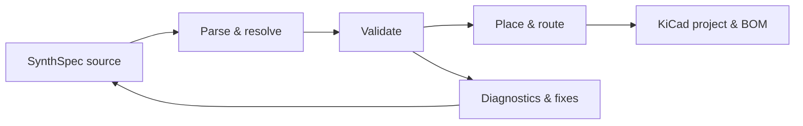
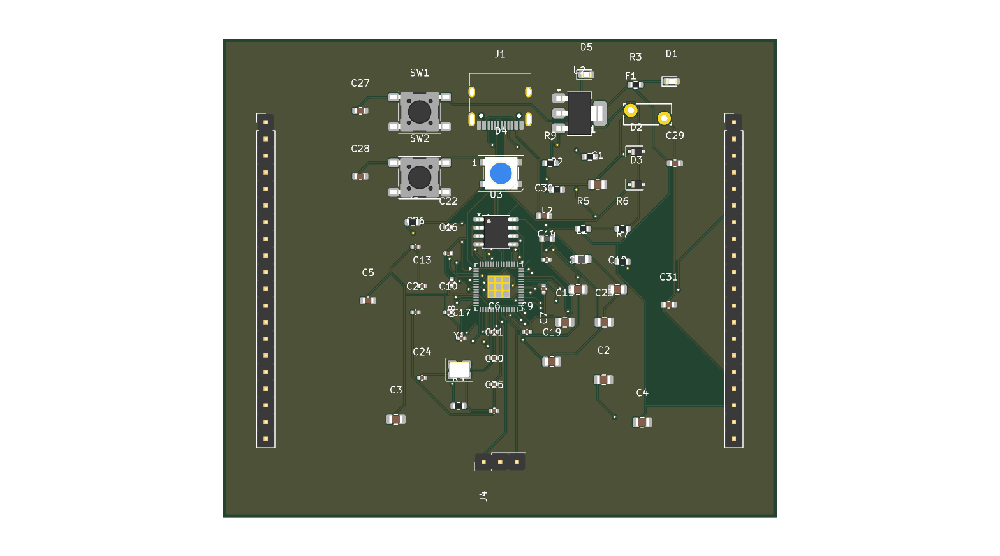

<div align="center">


### Design circuit boards as code.

Turn text-based circuit designs into KiCad schematics, PCB layouts, and bills of materials.

[](https://github.com/absmach/synth/actions/workflows/ci.yml)
[](LICENSE)

[Install](#install) · [Quick Start](#quick-start) · [Features](#features) · [Examples](#examples) · [Documentation](https://absmach.eu/docs/synth/user-guide/quick-start/) · [Contributing](#contributing)

</div>

## Introduction

Synth is an open-source compiler for electronic circuit boards. Describe components, connections, and board constraints in **SynthSpec**, a text-based design language; Synth checks the design and generates KiCad schematics, PCB layouts, and a bill of materials. Your `.synth` files hold the design intent, so you can edit them in your usual editor and review changes in Git. Engineers drive it from the command line, and AI agents drive the same compiler through its **Model Context Protocol (MCP)** server.

```synth
board "env_logger" {
    layers 2
    manufacturer "jlcpcb"

    group "USB-C INPUT / 3V3 LDO" color "#c2410c" {
      component J1: connector "usb_c_receptacle"
      component U1: regulator "ams1117_3v3" value "AMS1117-3.3"
      component C2: capacitor "c_generic_0805" value "22uF"
    }

    connect J1.vbus -> U1.vin
    connect J1.gnd  -> U1.gnd
    connect U1.vin  -> C2.p1
}
```

_An excerpt from the [environmental logger](examples/env_logger/env_logger.synth); the full design adds the MCU, sensor, CC pull-downs, and decoupling that the checks require._

<div align="center">

[](https://asciinema.org/a/0CN3lGs7SnY9QV7u)

_An agent designing a two-layer NE555 LED blinker through the MCP server: searching the registry, authoring a missing part, setting placement overrides, and validating the board._

</div>

## Install

### Prebuilt binary

Every [release](https://github.com/absmach/synth/releases) ships a `synth` binary for five platforms, each with a SHA-256 checksum beside it.

| Platform       | Asset                     |
| -------------- | ------------------------- |
| Linux x86-64   | `synth-linux-amd64`       |
| Linux arm64    | `synth-linux-arm64`       |
| macOS arm64    | `synth-darwin-arm64`      |
| macOS x86-64   | `synth-darwin-amd64`      |
| Windows x86-64 | `synth-windows-amd64.exe` |

```bash
base="https://github.com/absmach/synth/releases/latest/download"
asset="synth-linux-amd64"          # pick your platform from the table above

curl -LO "$base/$asset"
curl -LO "$base/$asset.sha256"
sha256sum -c "$asset.sha256"       # macOS: shasum -a 256 -c "$asset.sha256"

sudo install -m 755 "$asset" /usr/local/bin/synth
synth --version
```

Verify the checksum before running the binary. On Windows, check it with `certutil -hashfile synth-windows-amd64.exe SHA256` and compare against the `.sha256` file.

The Linux binaries are built against glibc 2.35, so they run on Debian Bookworm, Ubuntu 22.04, and newer.

> [!NOTE]
> The component registry and example designs ship inside the repository and track `main`, which has moved ahead of the latest release. Pair a prebuilt binary with its own tag (`git checkout v0.1.1`, where the example paths differ from those below), or install from source to follow the Quick Start as written.

### Cargo

Synth is not on crates.io, so install it from Git. Requires Rust 1.85 or newer.

```bash
# Latest release
cargo install --git https://github.com/absmach/synth --tag v0.1.1 --locked synth-cli

# Current main
cargo install --git https://github.com/absmach/synth --locked synth-cli
```

> [!WARNING]
> Do not run `cargo install synth-cli`. The `synth-cli` crate on crates.io is an unrelated project — a WebAssembly-to-ARM compiler — not this one.

### From source

```bash
git clone https://github.com/absmach/synth.git
cd synth
cargo build -p synth-cli --release
./target/release/synth --help
```

The repository pins its toolchain in `rust-toolchain.toml`, so rustup fetches the right version automatically.

## Quick Start

Validate the minimal example and export a KiCad project. The example designs come from a checkout, so clone the repository (or `cd` into it) first:

```bash
synth validate fixtures/designs/hello.synth
synth export-kicad fixtures/designs/hello.synth --out output/hello
```

The minimal example declares an empty two-layer board. Use the [example designs](#examples) to explore circuits with components and connections.

For machine-readable diagnostics:

```bash
synth validate examples/env_logger/env_logger.synth --format json
```

Open exported projects in KiCad. Optional Gerber, drill, and STEP exports require `kicad-cli`; see the [KiCad workflow guide](docs/kicad-workflows.md) for export and review details.

For CI and release gates, `synth check DESIGN.synth --json` is the deterministic, model-free gate for validation and DRC. A check that could not run is reported as `unknown` and blocks just as a failure does — see [release checks](docs/release-checks.md).

### Logging

Progress, retries, and degraded-check notices go to stderr as structured log events; stdout carries only the command's own output (JSON, reports, listings), so a pipeline can parse it without stripping prefixes. The default level is info. `-v` raises it to debug, `-vv` to trace, and `-q` shows errors only. `SYNTH_LOG` overrides both when one stage needs more detail:

```bash
synth -v export-kicad board.synth --out output/board
SYNTH_LOG=synth_router=debug,synth=info synth route board.synth
```

### Agent Integration

Start the MCP server over standard input and output:

```bash
synth mcp --stdio
```

Agents can retrieve the SynthSpec language reference, search the registry, validate designs, apply fixes, and invoke compiler stages. See the [MCP guide](crates/synth-mcp/README.md) for transports and tool details.

## How It Works



Synth resolves parts from a component registry and lowers the source into a typed board representation. Compiler stages use that shared representation for electrical checks, layout, routing, and export. A local browser viewer displays the schematic and diagnostics as you edit.

## Features

| Area               | Capabilities                                                                                                                                    |
| ------------------ | ----------------------------------------------------------------------------------------------------------------------------------------------- |
| Design language    | SynthSpec parser, typed board IR, components, connections, differential pairs, keepouts, and placement hints                                    |
| Validation         | Electrical-rule checks, design-rule checks, structured diagnostics with source locations and suggested fixes, and SMT-backed quantitative fixes |
| Layout and routing | Deterministic schematic layout, component placement, and multilayer routing, so generated artifacts are reproducible                            |
| KiCad integration  | Project, schematic, PCB, and BOM export; optional fabrication outputs through `kicad-cli`                                                       |
| Component registry | Versioned parts, project and user overlays, search, import, and authoring tools                                                                 |
| Developer tools    | CLI, JSON diagnostics, and an MCP server exposing validation, registry search, placement, routing, and export                                   |

## Examples

| Design                                                                                             | What it demonstrates                                                          |
| -------------------------------------------------------------------------------------------------- | ----------------------------------------------------------------------------- |
| [Hello](fixtures/designs/hello.synth)                                                              | The smallest board declaration                                                |
| [Environmental logger](examples/env_logger/env_logger.synth)                                       | USB-C power, a regulator, an MCU, an environmental sensor, and a debug header |
| [Sensor logger](examples/sensor_logger/sensor_logger.synth)                                        | A larger design with dual I²C sensors, SPI flash, and status LEDs             |
| [Placement and differential pairs](examples/placement_and_diff_pair/placement_and_diff_pair.synth) | Placement hints, differential-pair constraints, and keepout regions           |
| [RP2350 development board](examples/rp2350/)                                                       | Clean-netlist FreeRouting, zone refill, and compact outlines                  |

Additional language and validation cases live in [fixtures](fixtures/designs/README.md). Part definitions live in the [component registry](registry/README.md).



_Pre-generated compact RP2350 routed review artifact; open the [KiCad board](examples/rp2350/rp2350_devboard_freerouting_clean.kicad_pcb)
for an interactive review._

## Documentation

- [Release checks](docs/release-checks.md) — the `synth check` gate, tri-state native stages, and export overrides.
- [KiCad workflows](docs/kicad-workflows.md) — exported projects, validation, BOMs, and fabrication outputs.
- [Schematic procedures](docs/schematic-procedures.md) — schematic generation and review.
- [Diagnostic reference](docs/diagnostics/README.md) — diagnostic codes and repair guidance.
- [Diagnostic protocol](docs/protocol-v1.0.md) — the machine-readable diagnostic format.
- [Component registry](registry/README.md) — part definitions and registry structure.
- [MCP server](crates/synth-mcp/README.md) — agent tools and integration.

## Contributing

Contributions to the compiler, component registry, examples, and documentation are welcome. Use [issues](https://github.com/absmach/synth/issues) to report bugs or discuss a change, and submit a pull request with a focused description and relevant validation.

Before submitting code, run the workspace checks:

```bash
make verify
```

This checks formatting, compilation, Clippy lints, the workspace tests, and registry tests. Run `make help` to see individual development commands.

## License

Synth is licensed under the [Apache License 2.0](LICENSE).
