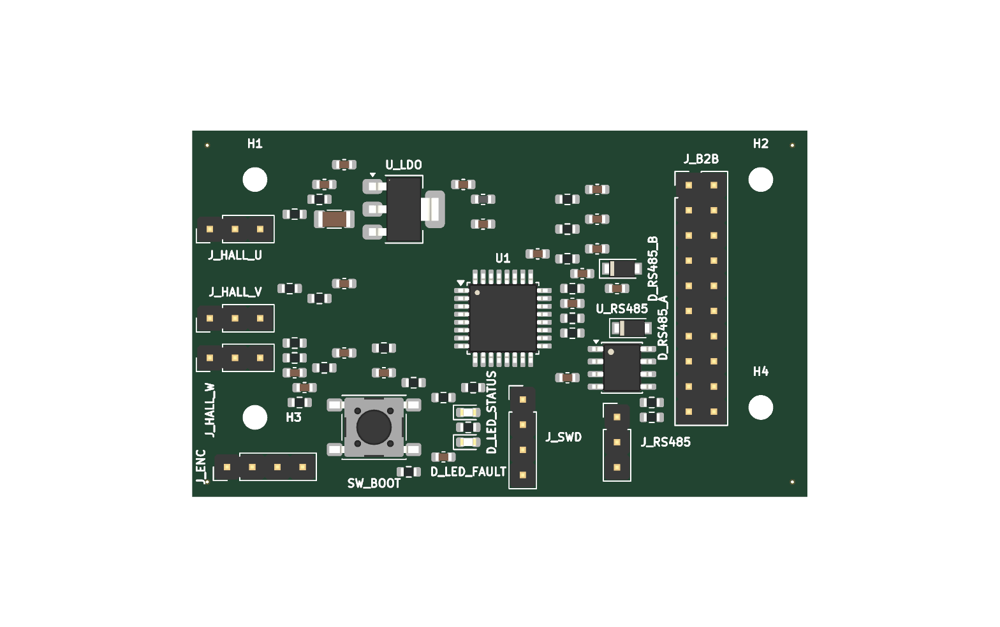
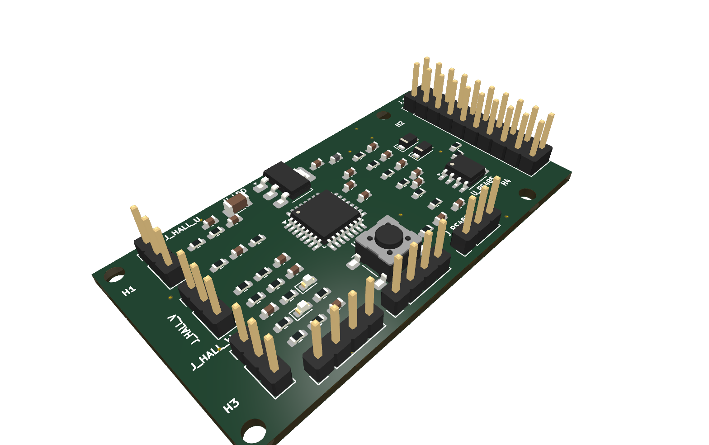
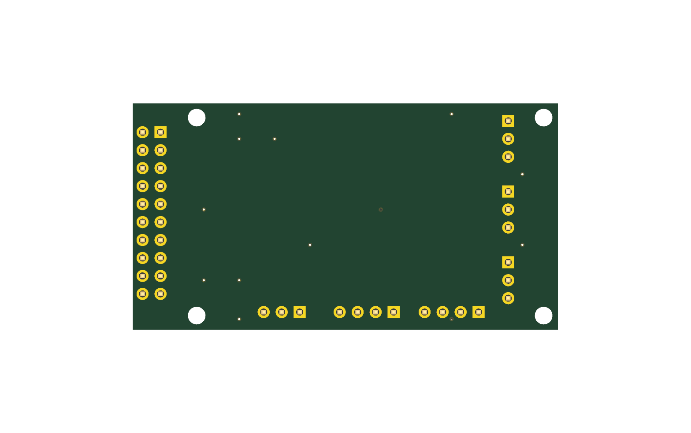
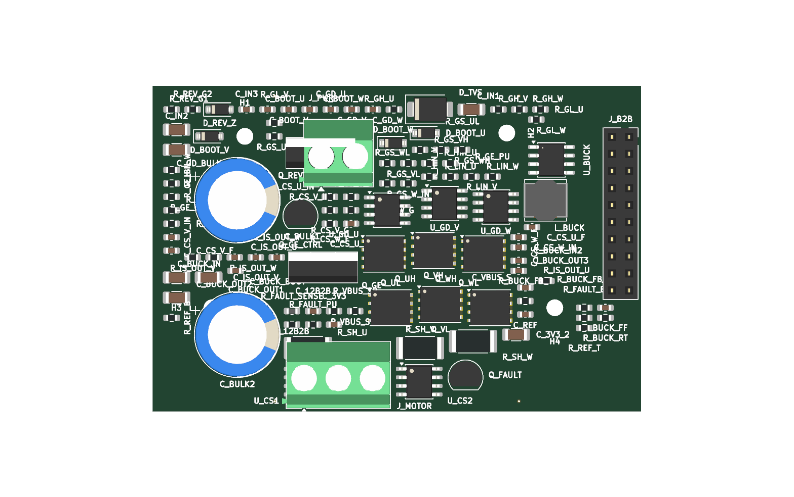
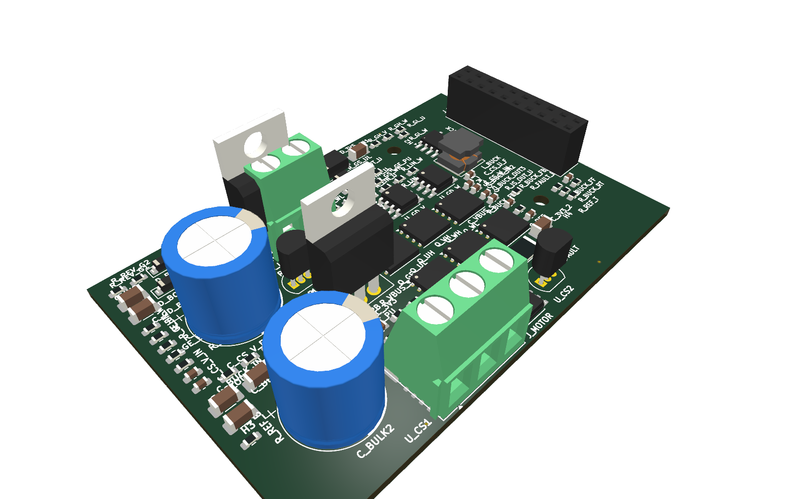
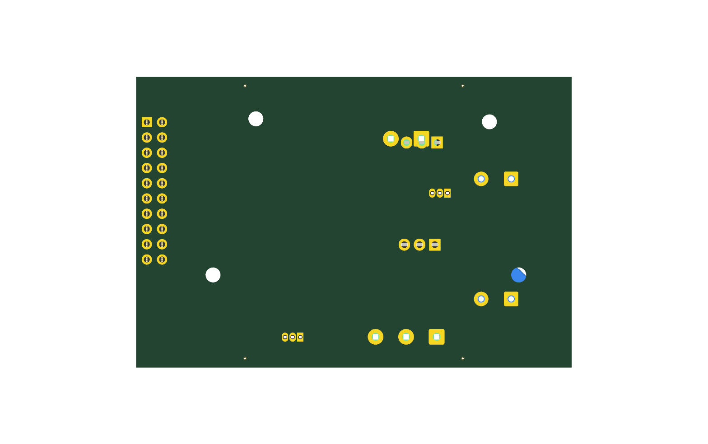

# BLDC two-board stack: control + power stage (SYN-408)

Status: two sources, two placement sidecars, one inter-board mapping file, four
negative variants and a six-test acceptance suite. Both sources validate with
zero errors. The multiboard check reports 20 of 20 J_B2B pins matched. No board
was fabricated or powered. FreeRouting 2.4.1 on Temurin 25 routes the control
board to 39 of 40 nets with 0 KiCad DRC errors; the one open is a +3V3
decoupling island, so the delivered projects keep their un-routed PCBs and
`release_ready` is false (see "Routing").

Intended for a 24 V, 10 A motor bus and a 12 V logic rail. The control board
takes 12 V through J_B2B, makes 3.3 V with an AMS1117-3.3, and runs an
STM32G030K8. The power board takes 24 V, protects it with a P-FET and an
SMBJ30A, drives three half bridges with IR2101 gate drivers and BSC030N08NS5
MOSFETs, measures the low-side current with 5 mOhm shunts and MCP6022
amplifiers, and makes 12 V with an LMR38010 buck.

## What

- `control.synth` (board `bldc_control`, 61 components, 40 nets),
  `power.synth` (board `bldc_power`, 111 components, 53 nets). The control is
  a 6-layer, 1.6 mm stack with 0.035 mm copper on every layer; the power board
  is 4-layer with a declared 0.07 mm outer-copper / 0.035 mm inner-copper
  stackup.
- `control.placement.layout.toml` and `power.placement.layout.toml`: every part
  is hand-pinned. J_B2B and H1-H4 sit at the same board coordinates on both
  boards; the mechanical test enforces 0.1 mm.
- `interboard_mappings.json`: the single source of truth for the 20 cross-board
  pins. `mappings_neg_swap.json`, `mappings_neg_drop.json`,
  `mappings_neg_voltage.json` and `control_neg_swap.synth` are the negatives.
- `crates/synth-cli/tests/bldc_stack_board.rs`: the six acceptance tests.
- `kicad/control/`, `kicad/power/`, `reports/`, `images/`, `BOM_sourcing.md`.
- `agent-run/`: the prompt, every tool call, the design notes, pin map, netlist,
  power budget, assembly and bring-up notes, and the verification report.

## Board size

The J_B2B pinout and the four mounting holes need a common frame. Both sidecars
place J_B2B at (56.88, 16) mm and the holes at (2, 2), (51, 2), (2, 30) and
(51, 30) mm. The power sidecar uses the same interface; its PCB is exported
un-routed for the 3D renders, like the control.

The control board declares `outline 60mm x 32mm`, so Edge.Cuts is exactly
**60 x 32 mm** with its origin at (0, 0) and no fitted margin. J_B2B is 25.4 mm
long, so the board height is the connector plus 3.3 mm at each end, and the
connector body sits within 0.33 mm of the right edge; the 0.5 mm
edge-clearance rule keeps its inner pad row just inside the board. The holes sit on the edge: a 2 mm
centre with a 1.25 mm drill leaves a 0.75 mm rim. The right-hand pair is on the
top and bottom edges at x = 51 mm because the 25.4 mm connector owns the whole
right edge; a hole cannot share that edge without sitting under the connector.

The six-layer ground planes are stitched by four 0.6 mm vias at the quarter
points of the top and bottom edges plus nine interior GND vias, away from every
mounting hole. A copper zone on each layer is not an electrical connection
between layers; without these vias the planes are unstitched before routing.

The three Hall connectors are vertical 1x3 headers in a column on the left, with
their filter parts in the same three rows. The three headers on the bottom edge
(J_ENC, J_SWD, J_RS485) share one pin-row height. Every resistor, capacitor and
inductor sits on a 3.0 mm grid (the KiCad 0603 courtyard is 2.96 mm wide, so a
2.5 mm grid forced the legaliser to nudge parts off their slots).

The passive reference labels are hidden on the silkscreen (the sidecar `[labels]`
table) so the auto-placed text does not collide; every part is still in the BOM
and the pick-and-place.

## Renders

Both delivered PCBs are un-routed, so these show placement and 3D bodies, not
copper. They were generated with `kicad-cli pcb render` from the delivered
board files. Every part with a body in the installed KiCad 3D library renders
with that body; the four mounting holes have no 3D model in the library and
render as holes.

### Control board

3D top:


3D angled:


3D bottom:


### Power board

3D top:


3D angled:


3D bottom:


## Cross-board check: what Synth actually does

`synth_export_multiboard` was extended in this branch. Before the change it
only checked that each mapping named an existing board and component: it did
not load boards at all, so every real mapping failed as "unknown board". The
check now:

1. Resolves every `from_pin`/`to_pin` against the part's real pin numbers and
   names (`E-SYNTH-MULTIBOARD-002`).
2. Compares the two pin names, and the declared net names of signal nets, so a
   swapped source pin or a swapped mapping is caught
   (`E-SYNTH-MULTIBOARD-003`).
3. Requires every pin of a mapped connector to appear exactly once
   (`E-SYNTH-MULTIBOARD-004`).
4. Compares the inferred voltage domains of the two nets and rejects a ground
   mapped to a rail or rails more than 10 % apart
   (`E-SYNTH-MULTIBOARD-005`).
5. Still reports an unknown board or component as
   `E-SYNTH-MULTIBOARD-001`.

It is a structural check. It does **not** prove that the two boards' copper
can carry the current, that the connector is correctly keyed, or that the
boards' stack height mates. It is not a voltage-isolation or creepage check.

The good mapping is 20/20, 100 %. Each negative is rejected:

| Negative | Code | Meaning |
| --- | --- | --- |
| `mappings_neg_swap.json` | 003 | J_B2B pin 1 (PWM_UH) mapped to power pin 2 (PWM_UL) |
| `mappings_neg_drop.json` | 004 | pin 20 has no mapping |
| `mappings_neg_voltage.json` | 003/005 | 12 V and 3.3 V pins exchanged |
| `control_neg_swap.synth` | 003 | source wires PWM_UH/PWM_UL to pins 2/1 |

The old MCP server configured in this session is a different checkout
(`synth-mcp-main`) and still has the pre-change tool: it reports all 20 pins as
unknown boards. The Rust test calls this branch's `synth_mcp::call_tool`
directly, which is the code the branch ships. This is recorded in
`agent-run/tool-calls.md`.

## Connector current and derating

J_B2B is a 2 x 10, 2.54 mm pin header (ZHOURI C5116480) and socket (BOOMELE
C30867), rated 2.5 A per contact (LCSC product pages and the datasheet extracts in `datasheets/`, read 2026-11-03 with Firecrawl). The bracket uses a 50 %
derating, 1.25 A per contact. No contact carries more than 0.13 A.

| J_B2B pin | Net | Direction | Worst-case current | Against 1.25 A |
| --- | --- | --- | --- | --- |
| 1-6 | PWM_UH/UL/VH/VL/WH/WL | control -> power | 4 mA (IR2101 input + 10 k pulldown) | 0.3 % |
| 7-9 | ISENSE_U/V/W | power -> control | 2 mA (1 k into the control filter) | 0.2 % |
| 10 | VBUS_SENSE | power -> control | 3 mA (divider and 1 k) | 0.2 % |
| 11 | GATE_EN | control -> power | 0.33 mA (10 k base resistor) | 0.03 % |
| 12 | FAULT_N | power -> control | 0.33 mA (10 k pull-up) | 0.03 % |
| 13 | +3V3 | control -> power | 100 mA (power-board logic) | 8 % |
| 14 | +12V_LOGIC | power -> control | 120 mA (LDO input and gate drivers) | 9.6 % |
| 15-20 | GND | return | 220 mA total | 17.6 % on one pin |

The 24 V / 10 A current does not pass through J_B2B; it enters the power board
on J_PWR and leaves on J_MOTOR. Those are Phoenix MKDS 1,5/5.08 terminals
rated 17.5 A, and the motor terminal is used at 10 A (57 % of rating).

## Power budget

| Rail | Source | Loads (datasheet/design) | Limit | Margin |
| --- | --- | --- | --- | --- |
| VBUS 24 V | J_PWR, 10 A external limit | 3 half bridges, 12 V buck, sense divider | 10 A stated | 0 % at the stated limit; no fuse fitted |
| +12V | LMR38010, 1 A | control LDO 84 mA, 3 gate drivers 15 mA, margin | 1 A | 90 % |
| +12V_GD | Q_GE switch from +12V | 3 IR2101 VCC + gate charge | 1 A | >90 % |
| +3V3 | AMS1117-3.3, 800 mA | MCU 20 mA, RS-485 3 mA, Hall 30 mA, encoder 10 mA, LEDs 6 mA, op-amps 3 mA, quiescent 5 mA | 800 mA | 90 % |
| 3.3 V (power board) | J_B2B pin 13 | 2 x MCP6022 2 mA, reference and pull-ups 2 mA | connector 2.5 A | >99 % |

Conduction estimate at 10 A: reverse P-FET 20 mOhm -> 2.0 W; three conducting
low/high-side FETs at 3 mOhm -> 0.9 W; three shunts at 5 mOhm -> 1.5 W; 12 V
buck about 0.15 W. Total about 4.8 W before switching and gate-drive losses.
The 2 oz outer copper, the 2 mm phase tracks and the thermal vias under the
MOSFETs are sized for that, but the junction temperatures are not computed.

The AMS1117-3.3 at 12 V in and 84 mA out dissipates (12 - 3.3) x 0.084 =
0.73 W. `synth validate` emits `W-SYNTH-THERMAL-001` because the part's declared
maximum dissipation is 1360 mW and its 60 C/W figure puts the junction near
107 C. That is a warning from the part's worst case, not a measured
temperature; a real thermal review has to close it.

## Parts and datasheets

| Part | Datasheet | Values used | Conflict or gap |
| --- | --- | --- | --- |
| U1 STM32G030K8T6 (LQFP-32) | ST DS12991 Rev 6 | 2.0-3.6 V, 64 KB, pins per the reviewed registry entry | none checked beyond the registry entry |
| U_LDO AMS1117-3.3 (SOT-223) | Advanced Monolithic DS1117 | 800 mA, 15 V max in, 1.3 V dropout | no `[provenance]` in the seed part |
| U_RS485 THVD1450D | TI SLLS... (THVD1450) | 3.3-5.5 V, 50 Mbit/s, +/-18 kV IEC ESD | seed part, not reviewed in this branch |
| D_RS485_A/B PTVS6V0S1UR | Nexperia | 6 V standoff, SOD-323 | second-stage clamp only |
| U_GD_U/V/W IR2101STRPBF | Infineon IR2101 | 600 V, 210/360 mA, VCC 10-20 V | authored; no reviewer |
| Q_UH..Q_WL BSC030N08NS5 | Infineon BSC030N08NS5 | 80 V, 100 A, 3.0 mOhm max, TDSON-8 | authored; 80 V part used where the issue suggests 40 V |
| Q_REV, Q_GE IRF4905PBF | Infineon IRF4905 | -55 V, -74 A, 20 mOhm | authored; TO-220 |
| U_CS1/2 MCP6022-I/SN | Microchip DS20001685E | 10 MHz, 2.5-5.5 V, SOIC-8 | authored; the registry's DIP part was not used |
| U_BUCK LMR38010SDDAR | TI SNVSBM3B | 4.2-80 V, 1 A, VREF 1.0 V, 85 V abs max | reviewed registry part |
| J_B2B plug/socket | ZHOURI C5116480 / BOOMELE C30867 | 2 x 10, 2.54 mm, 2.5 A/contact | authored; LCSC product pages read 2026-11-03 with Firecrawl; the linked PDFs are 3D models |
| J_PWR/J_MOTOR MKDS 1,5/5.08 | Phoenix Contact 1715721/1715734 | 17.5 A, 400 V (III/2), 5.08 mm, 0.9 x 0.9 mm pin | authored; LCSC C480516/C480520; datasheets read 2026-11-03 with Firecrawl; JLC lists 250 V |
| C_BULK1/2 EEU-FR1H471 | Panasonic | 470 uF, 50 V, 12.5 x 20 mm | authored; 50 V is 2.1x the 24 V rail |
| D_TVS SMBJ30A | Vishay 88392 | VWM 30 V, VBR 33.3-36.8 V, VC 48.4 V | registry part |
| BZT52C15 | Diodes BZT52Cxx | 15 V, 500 mW, SOD-123 | authored; gate-source clamp |
| Q_FAULT/Q_GE_CTRL 2N3904 | onsemi 2N3903/2N3904 | 40 V VCEO, 200 mA, TO-92 | registry entry corrected from 5 V/100 mA |
| Passives | generic registry parts | values in the sources | no MPN, no datasheet |

The Firecrawl text extracts for the terminal blocks, the 2 x 10 connectors and the
2N3904 are in `datasheets/`; the PDFs themselves are not committed.

## Routing (recorded, not hidden)

`synth export-kicad ... --router free-routing` hands the board to
`tools/freeroute_autoroute.py`. FreeRouting 2.4.1 is Java 25 bytecode: Java 21
fails with `UnsupportedClassVersionError`, and some runs also hit a
`PROPERTY_ENUM` assert in the adapter's `pcbnew` step.

The 2026-11-05 run with Temurin 25 completes for the control board: 39 of 40
nets, 532 segments, 84 vias and 0 KiCad DRC errors. The one open is a +3V3
decoupling island of six pads around `U_LDO.2`, not a missing trace. The
candidate therefore fails independent connectivity and is not installed; the
delivered control PCB stays un-routed. The power board is exported un-routed
for the 3D renders. Its FreeRouting run exceeded the 30-minute cap and was
stopped, so there is no power routing record. `release_ready` is false in the
control project and `reports/control.routing.json` names the exact open.

The power placement itself is not DRC-clean: the hand-pinned sidecar has
overlapping courtyards around `J_MOTOR`/`U_CS1`/`R_SH_U`,
`J_PWR`/`Q_REV` and `H3`/`C_BULK2`, and the TO-92 `Q_FAULT` pads are closer
than the 0.3 mm `PWR` clearance. `kicad-cli pcb drc` reports 32 errors and 178
unconnected pads on the un-routed board (`reports/power.drc.json`). It is
rendered for review, not fabrication. `synth check <board> --json` and `--fab
--json` were not run to a pass; see `agent-run/VERIFICATION_REPORT.md`.

## Not verified by Synth

- Gate-driver dead time and shoot-through. IR2101 has no internal dead time;
  the STM32 must insert it, and no tool here checks the firmware.
- Power-loop inductance, phase-node ringing, snubber design, EMI and motor-side
  transients (back-EMF, inductive kick, cable reflections).
- Thermal junction temperatures beyond the `W-SYNTH-THERMAL-001` warning.
- Connector keying, stack height, mating force and creepage/clearance at 24 V.
- Current-sense accuracy, offset, bandwidth and common-mode range in the real
  layout; the gain-40 calculation is in `DESIGN_NOTES.md`, not measured.
- The 12 V buck's loop stability and the AMS1117's thermal margin.
- Fabrication: no board was built, no fab accepted the Gerbers, and no part was
  purchased. The 2 oz outer copper and any via-in-pad process were not quoted.
- The `SHA256SUMS` values were generated locally; no CI run has produced a
  golden set for this board.

## Reproduce

```
export XDG_DATA_HOME=$(mktemp -d)
export KICAD_SYMBOL_DIR=/usr/share/kicad/symbols KICAD_FOOTPRINT_DIR=/usr/share/kicad/footprints
scripts/setup-routing-engines.sh --freerouting-only
B=qualification/class-d/bldc-stack
synth validate $B/control.synth
synth validate $B/power.synth
cargo test -p synth-cli --test bldc_stack_board
# The control routes 39/40 and keeps its un-routed baseline; the power board
# is exported un-routed for the renders:
SYNTH_SOURCE_REVISION=$(git rev-parse HEAD) synth export-kicad $B/control.synth \
  --out out/control --allow-unverified-parts --allow-incomplete --validate-erc \
  --router free-routing
SYNTH_SOURCE_REVISION=$(git rev-parse HEAD) synth export-kicad $B/power.synth \
  --out out/power --allow-unverified-parts --allow-incomplete --validate-erc \
  --router free-routing
kicad-cli sch erc --severity-all --format json -o $B/reports/control.erc.json $B/kicad/control/bldc_control.kicad_sch
kicad-cli sch erc --severity-all --format json -o $B/reports/power.erc.json $B/kicad/power/bldc_power.kicad_sch
cd $B && grep -v '^#' SHA256SUMS | sha256sum -c -
```
